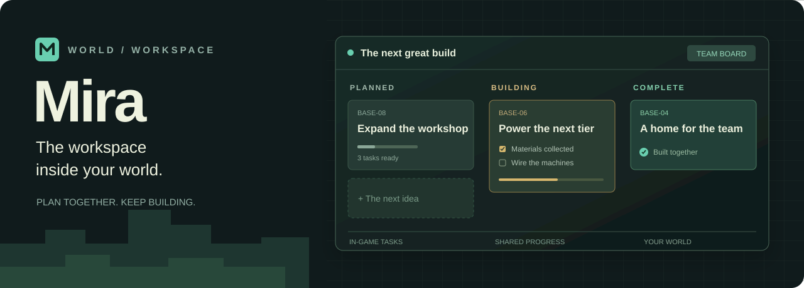
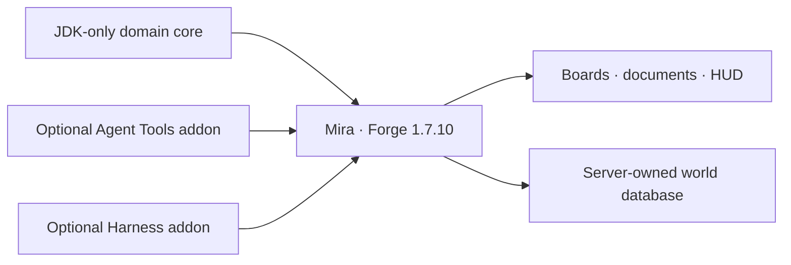

<p align="center">
  
</p>

<p align="center">
  <a href="https://github.com/sorivma/mira/actions/workflows/build.yml"></a>
  <a href="https://github.com/sorivma/mira/releases"></a>
  
  
  <a href="LICENSE"></a>
</p>

<p align="center">
  <b>Plan the next machine. Share the work. Stay in the world.</b><br>
  Collaborative boards, task documents, workflows, and an optional bridge to your agents.
</p>

<p align="center">
  <a href="https://github.com/sorivma/mira/releases/latest">Download</a> ·
  <a href="docs/user-guide.md">User guide</a> ·
  <a href="docs/integrations.md">Integrations</a> ·
  <a href="CONTRIBUTING.md">Contribute</a> ·
  <a href="README.ru.md">Русский</a>
</p>

## A workspace that lives with your world

Mira is a Forge mod for Minecraft **1.7.10**. Press **J** to open your team's
workspace: a board for the next build, a backlog for future plans, and a shared
record of what is done. The server owns permissions and saves the database
inside the world; no external database or service is required.

| Plan | Collaborate | Connect |
| --- | --- | --- |
| Boards, backlog, issues, sprints, search, and templates | Private workspaces, Owner / Editor / Viewer roles, comments, and live updates | Optional MCP task tools and live cards in Minecraft Harness |
| Drag cards between statuses; design your own workflow | Field-level conflict handling, durable saves, archive/restore, and guarded undo | Markdown, checklists, material requirements, locations, and blockers |
| Pin a task to the HUD and keep building | Projects inherit workspace permissions | Optional NEI item picker; held-item entry works without NEI |

Remote Markdown images wait for a click and confirmation before downloading.
Resource-pack images stay local. Full controls and editing behavior are in the
[user guide](docs/user-guide.md) and [UI guide](docs/ui.md).

## Install

1. Download `mira-0.1.1.jar` from [Releases](https://github.com/sorivma/mira/releases).
2. Place it in `mods/` on the **client and server** running Minecraft 1.7.10
   with Forge 10.13.4.1614.
3. Enter the world and press **J**. Create a workspace, then invite players under
   **Settings → Access**.

The base mod is self-contained. Do not install `-dev.jar`, `mira-core-*.jar`,
or fixture jars in a game. The ZIP also contains optional integrations and
developer artifacts: follow its `INSTALLATION.md` before copying files.

**Compatibility:** built for Forge 1.7.10, with GT New Horizons 2.9.0-RC-2 as a
target pack. Automated checks cover domain rules, synchronization helpers, and
final jar contents. Full-pack client/server acceptance remains separate;
see the [verification record](docs/verification.md).

## Choose your integrations

| Artifact | Requires | Adds |
| --- | --- | --- |
| `mira-0.1.1.jar` | Forge | Complete collaborative workspace |
| `mira-agent-tools-1.7.10-0.1.1.jar` | Mira + [Minecraft Agent Tools](https://github.com/sorivma/minecraft-agent-tools) | Eleven `mira_*` tools for scoped task reads and permission-checked writes |
| `mira-harness-1.7.10-0.1.1.jar` | Mira + [Minecraft Harness](https://github.com/sorivma/minecraft-harness) | Live task cards with an **Open Mira** action |

The addons are optional client integrations. The MCP addon is copied to both
`mods/` and `config/minecraftagenttools/plugins/`. Harness cards work without
the MCP addon. See the [installation matrix](docs/release-installation.md) and
[full integration guide](docs/integrations.md).

## Build

Use the checked-in **Gradle 9.5.0** wrapper. Gradle and core compilation use
**JDK 25**; Forge compiles with **JDK 8** and its decompiler uses **JDK 17**.
Every production class targets Java 8.

```powershell
$env:JAVA_HOME = 'C:\Java\jdk-25'
$env:MIRA_JAVA8_HOME = 'C:\Java\jdk-8'
$env:MIRA_JAVA17_HOME = 'C:\Java\jdk-17'
.\gradlew.bat :core:check
.\gradlew.bat check build
```

The core check needs only JDK 25 and does not configure Forge or download game
artifacts. To build the addons using verified APIs from the sibling projects'
`v0.1.0` releases:

```powershell
python scripts/fetch-integration-apis.py
$integrationArgs = Get-Content .work/integration-apis/gradle-args.txt
.\gradlew.bat @integrationArgs check checkIntegrations assembleIntegrations
python scripts/package-release.py
```

Python 3 and GitHub CLI are needed for the release helper scripts. The
[build baseline](docs/build-baseline.md) records exact JDK selections;
[Contributing](CONTRIBUTING.md) explains development checks.

## Architecture



The domain core owns transactions, permissions, workflows, and task bodies.
The Forge layer supplies storage, networking, inventory observation, and UI.
Addons use the existing backend; they do not create a second task database.

| Read next | |
| --- | --- |
| [Architecture](docs/architecture.md) | Module boundaries and dedicated-server-safe loading |
| [Backend](docs/backend.md) | Persistence, permissions, synchronization, recovery |
| [Versioning](VERSIONING.md) | Compatibility promises and release procedure |
| [Changelog](CHANGELOG.md) | What changed |
| [Security](SECURITY.md) | Trust boundaries and private reporting |

## Community and license

Use [issues](https://github.com/sorivma/mira/issues) for reproducible bugs and
feature proposals, or [Discussions](https://github.com/sorivma/mira/discussions)
for setup and workflow questions.

Mira is [MIT licensed](LICENSE). Bundled dependencies retain their own
[notices](THIRD_PARTY_NOTICES.md). This is an independent community project,
not an official Minecraft, Mojang, Microsoft, or GT New Horizons product.
